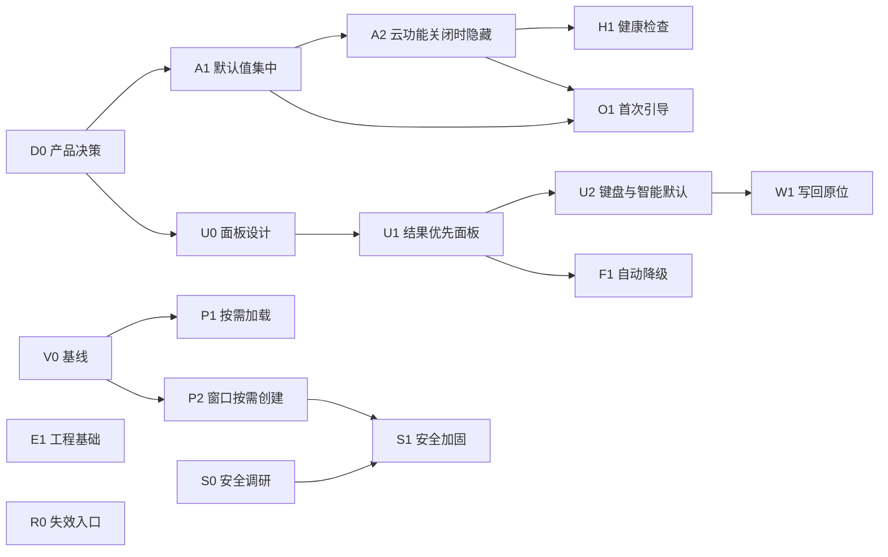

# TransKit fork 优化路线图

> 状态：已确认，执行中 · 适用分支：`custom/main` · 起草日期：2026-11-24
>
> 本文是这个 fork 下一阶段优化的总体规划：先给出评估结论，再把工作拆成可独立交付的任务，标明依赖、并行关系和每项的验收方式。之后按本文逐项开任务（分支 / PR），任务完成后回到这里更新状态。

## 1. 结论

TransKit 的能力已经铺得很广：28 个翻译引擎、10 个 TTS、10 个 AI、15 个 OCR、11 个语音识别，另有 Live Interpreter、Voice Anywhere、本地模型 sidecar 和划词操作层。底子扎实：Tauri + Rust，安装包约 16MB；关键能力走原生实现；服务商实例化架构灵活。

主要问题不在于功能少，而在于本 fork 最核心的使用路径——**选中文字 → 快速得到结果或执行动作**——还不够顺：首次运行的默认值有冲突，默认服务里有当前构建用不了的，结果被按钮墙挤到下方，失败时只给一条报错。

因此路线是：**先做减法、修基础，再在主路径上做加法。** 功能面不再继续扩张。

## 2. 关键发现（附代码证据）

### 2.1 使用体验

| # | 发现 | 证据 |
|---|---|---|
| UX-1 | **首次运行的默认值不确定。** `useConfig` 读不到配置时，会把调用处的默认值写进 store，也就是"谁先读谁定"。同一个键在不同文件里默认值不同，结果取决于用户先打开哪个窗口：先开设置页会得到"翻译成越南语、不记历史"，先划词会得到"翻译成中文、记历史"。 | `src/hooks/useConfig.jsx`；目标语言 `'vi'`（`Config/pages/Translate`）与 `'zh_cn'`（`LanguageArea`）；源语言 `'en'` 与 `'auto'`；`history_disable` 为 `true` 与 `false`（`TargetArea`）。共 7 个键的默认值冲突，读取它们的文件有 16 个。 |
| UX-2 | **默认服务里有本构建用不了的云服务。** fork 构建没有注入 Supabase 凭据，`CLOUD_ENABLED=false`，但默认列表里排着 `transkit_cloud_*`。AI 的默认列表只有云服务一项，所以 AI 动作首次使用必然失败。Account / Profile 入口照常显示。 | `src/utils/store.js` 中的 `SERVICE_LIST_DEFAULTS`；`useSelectionActions.js` 中的 `ai_service_list` 默认值；`Config/components/SideBar` 中的 AccountWidget |
| UX-3 | **划词面板把结果挤到下方。** 布局顺序是 原文 → 语言栏 → 面板 → 结果卡片。面板常驻约 5 行、13 个以上按钮，350px 宽的窗口里结果被压到最下面。 | `src/window/Translate/index.jsx`（约 494–640 行）；`SelectionActionPalette.jsx` |
| UX-4 | **只能用快捷键触发，没有鼠标触发方式。** 选区读取失败时会回退到模拟 Ctrl+C，之后只恢复纯文本和图片，其他剪贴板格式会丢失。 | `src-tauri/src/window.rs` 中的 `selection_translate`；依赖的 `selection` crate（Windows 实现） |
| UX-5 | **失败时没有出路。** 每张结果卡片各自请求、各自报错，没有自动降级到下一个服务（如 Google 429），也没有任何地方显示"哪个服务的 Key 有问题"。 | `TargetArea/index.jsx` 中的 `setError(e.toString())` |
| UX-6 | **fork 里有失效入口。** 更新地址已清空，但托盘仍有"检查更新"；托盘多语言文字写死在 Rust 里，中文仍叫"音频监听"，与界面上的 Live Interpreter 名称不一致。 | `src-tauri/src/tray.rs`；`tauri.conf.json` 中 `updater.endpoints: []` |

### 2.2 UI

- Live Interpreter 工具栏有近 20 个无文字图标，学习成本高。
- 设置页有 13 个分区，服务配置又分 6 个标签页；高级参数默认全部展开。
- 服务选择列表不区分常用与长尾，也不区分可用（已配置）与不可用。

### 2.3 实现

| # | 发现 | 证据 |
|---|---|---|
| IMP-1 | 前端打成一个 3.2MB 的 JS 和 680KB 的 CSS，没有按需加载；每个窗口都加载整个应用。 | `src/App.jsx` 静态导入全部窗口；本地执行 `vite build` 的产物 |
| IMP-2 | `monitor`、`voice_anywhere`、`voice_anywhere_caption` 三个窗口在启动时就预先创建并隐藏，不管用户是否使用这些功能。 | `src-tauri/tauri.conf.json` 中的 `windows` 配置 |
| IMP-3 | 约 140 个配置键的默认值散落在各个组件里，UX-1 就是这样来的。 | `useConfig(key, default)` 的各处调用 |
| IMP-4 | WebView 安全配置偏宽，需要专门调研后收紧（CSP、跨域、shell 范围、密钥存储）。 | `tauri.conf.json`、`window.rs` |
| IMP-5 | 存在大组件（`Monitor/index.jsx` 2268 行）；Rust 中约 206 处 `unwrap()`。 | — |
| IMP-6 | fork 实际上没有 CI：上游 workflow 只在 `master` 分支触发，而本仓库没有这个分支。测试只能手动运行；`.node-version` 仍是已停止维护的 Node 21。 | `.github/workflows/package.yml` |

> 尚未实测：内存占用、首次弹窗耗时。任务 V0 会先建立基线，性能类任务以它为对照。

## 3. 原则

1. **不删上游代码。** 减法放在默认值、界面和构建配置层面，避免以后合并上游时冲突。
2. **新代码放在 fork 自己的目录**（`src/features/`、新文件），尽量少改上游文件里的大段代码。
3. **上游同样存在的 bug 单独开 `upstream-pr/*` 分支回馈**：UX-1 默认值冲突、IMP-1 按需加载都属于这类。
4. **一个任务对应一个分支、一个 PR**，各有独立 worktree，基于 `custom/main`。
5. **每个任务写清楚需要哪一级验收。** 可以用代码测试验证的就用测试；涉及原生窗口、焦点、DPI、音频的，必须有真实 Windows 验收，不能只靠模拟测试。

## 4. 任务清单

难度：S 不超过半天，M 约 1–2 天，L 3 天以上。"上游"一列标记适合回馈上游的任务。

### 阶段 0：前置（不改产品代码）

| ID | 任务 | 改动范围 | 依赖 | 验收 | 难度 |
|---|---|---|---|---|---|
| G0 | 仓库整理：合并已完成的修复分支，清理过时的 worktree，确定任务跟踪方式（启用 Issues，或继续用本文加 PR） | Git 和仓库设置 | — | 分支和 worktree 清单与本文一致 | S |
| V0 | 性能与稳定性基线：用 release 构建测量空闲内存（所有 WebView2 进程合计）、首次和再次弹出翻译窗的耗时、启动耗时；记录测量方法 | 不改源码 | — | 一份可重复执行的测量记录 | S |
| D0 | 产品决策：默认语言和历史记录、默认翻译和 TTS 服务、面板常驻哪些动作（见第 7 节） | 不改源码 | — | 决策写回本文 | S |

### 阶段 1：基础（可并行）

| ID | 任务 | 改动范围 | 依赖 | 验收 | 难度 | 上游 |
|---|---|---|---|---|---|---|
| A1 | **集中管理配置默认值。** 新增默认值表，`useConfig` 优先使用表中的值；按 D0 的决策解决 7 个冲突键。不逐个改调用处。 | 新增 `src/utils/config_defaults.js`；`src/hooks/useConfig.jsx`；`src/utils/store.js` | D0 | 单元测试覆盖"无论先打开哪个窗口，默认值都一致"；全量测试通过；构建通过 | M | ✓ |
| E1 | **工程基础。** 加 `test` 脚本；新增 fork 自己的 CI（测试加前端构建，在 `custom/main` 和 PR 上触发，不改上游 workflow）；Node 升到 22 并在 22 上跑通测试；修复浏览器测试运行器参数中含 `</script>` 时出错的问题；明确 pnpm 锁文件为准（两份锁文件都保留，避免与上游冲突） | `package.json`；新增 `.github/workflows/fork-ci.yml`；`.node-version`；`browserRunner.mjs` | — | CI 在 PR 上运行并通过 | S | — |
| R0 | **清理 fork 失效入口。** 没有配置更新地址时隐藏"检查更新"；托盘名称和界面统一 | `src-tauri/src/tray.rs`（不碰 `updater.rs`） | — | 托盘菜单检查；`cargo check` 通过 | S | — |
| S0 | **安全调研**（只读）：查清哪些请求依赖跨域放开，CSP 在插件机制下能收到什么程度，shell 最少需要哪些权限，API Key 怎样加密存放，输出设计说明 | 不改源码 | — | 设计说明经评审通过 | S | — |
| U0 | **划词面板设计**（只读）："结果优先"布局、常驻 3–4 个动作加"更多"、键盘快捷键、按选区内容自动选默认动作的规则、写回原位的交互，输出设计稿和规则表 | 不改源码 | D0 | 设计经评审通过 | S | — |

### 阶段 2：主路径与减法

| ID | 任务 | 改动范围 | 依赖 | 验收 | 难度 | 上游 |
|---|---|---|---|---|---|---|
| A2 | **云功能关闭时彻底隐藏云相关内容。** 云服务从默认列表移除；6 个服务选择框隐藏云服务；隐藏 Account / Profile 入口和路由 | `config_defaults.js`；`Config/pages/Service/*/SelectModal`；`SideBar`；`routes` | A1 | 新用户的配置下，AI、TTS、语音识别首次使用都能成功；测试通过 | S | ✓（以 `CLOUD_ENABLED` 为条件） |
| U1 | **实现"结果优先"的划词面板**（按 U0）：结果在上，常驻动作加"更多"，语言栏可收起 | `SelectionActionPalette.jsx`；`Translate/index.jsx` 布局部分；i18n | U0 | 渲染测试；320–420px 宽度下的截图检查；真实 Windows 窗口验收 | M | — |
| P1 | **窗口按需加载代码。** `App.jsx` 按窗口用 `React.lazy` 拆分；必要时配置分包 | `src/App.jsx`；`vite.config.js` | V0 | 单个窗口的首屏 JS 明显变小；与 V0 对比首次弹窗耗时；各窗口冒烟测试 | S | ✓ |
| P2 | **不再预先创建窗口。** Monitor 和 Voice Anywhere 窗口改为首次使用时创建 | `tauri.conf.json`；`window.rs`（`monitor_window`、`voice_anywhere_window`）；`voice_anywhere.rs`；`updater.rs` | V0 | 与 V0 对比空闲内存；Live Interpreter 和 Voice Anywhere 的完整真实验收 | M | ? |

### 阶段 3：在主路径上做加法

| ID | 任务 | 改动范围 | 依赖 | 验收 | 难度 |
|---|---|---|---|---|---|
| U2 | **全键盘操作和智能默认动作**：数字键或字母键触发动作；单词自动查词典，句子自动翻译，已经是目标语言时提供润色或朗读 | `src/features/selection-actions/*`（不改 `Translate/index.jsx`） | U1 | 规则单元测试；键盘操作的渲染测试 | M |
| F1 | **服务自动降级和错误引导**：主服务失败（429、超时、鉴权失败）时自动启用备选；错误按类型给出处理建议 | `TargetArea/index.jsx`；`Translate/index.jsx` 中服务调度部分 | U1 | 模拟失败场景的测试；真实断网或 429 验收 | M |
| W1 | **写回原位**：划词时记下来源窗口；润色、改语法的结果可一键替换原选区（复用 Voice Anywhere 的粘贴能力） | `window.rs`（`selection_translate`）；新增 Rust 命令；面板上新增按钮 | U1、U2 | 在记事本、浏览器、Word 中真实验收；失败时退回"已复制到剪贴板" | M |
| H1 | **服务健康检查页**：一键测试每个已配置服务的 Key 和延迟，显示最近一次错误 | `Config/pages/Service/*/ServiceItem` 和新组件 | A2 | 模拟和真实服务各验一次 | M |
| O1 | **首次运行引导**：选语言、选主引擎、试一次快捷键、检查选区读取 | 新增页面和路由 | A1、A2 | 用全新配置目录完整走一遍 | M |
| S1 | **安全加固实现**（按 S0） | `tauri.conf.json`；`window.rs`（`build_window`）；存储层 | S0、P2 | 全部服务冒烟测试；插件仍可用 | M–L |

### 阶段 4：实验与长期

| ID | 任务 | 说明 |
|---|---|---|
| X1 | 鼠标触发浮标（实验开关） | 需要全局鼠标钩子，误触发和软件冲突的风险高；先做技术验证 |
| M1 | Live Interpreter 工具栏分组 | `Monitor/index.jsx` 属于上游代码且很大，优先作为上游提案 |
| L1 | 迁移到 Tauri v2 | 改动大，单独评估，不在本轮范围内 |

## 5. 依赖与并行

### 并行分组

把任务分成几条泳道。同一泳道内按顺序做；不同泳道之间改动的文件互不重叠，可以同时开发。

| 泳道 | 顺序 | 主要占用的文件 |
|---|---|---|
| 配置 | A1 → A2 → H1、O1 | `useConfig`、`store`、`config_defaults`、设置页的服务选择框和侧栏 |
| 翻译窗 | U0 → U1 → U2、F1 → W1 | `Translate/index.jsx`、`SelectionActionPalette.jsx`、`TargetArea` |
| 原生与性能 | V0 → P1、P2 → S1 | `App.jsx`、`vite.config.js`、`tauri.conf.json`、`window.rs` |
| 工程 | E1 | `package.json`、新 workflow、测试运行器 |
| 杂项 | R0 | `tray.rs` |

### 已知的文件冲突点

- **`Translate/index.jsx`**：U1、F1 都要改。约定由 U1 负责布局，F1 只改服务调度；F1 在 U1 合并之后再开始。
- **`window.rs`**：P2、S1、W1 都要改，但改的是不同函数（`monitor_window` / `voice_anywhere_window`、`build_window`、`selection_translate`）。按 P2 → S1 → W1 的顺序合并，每次从最新的 `custom/main` 开始。
- **`tauri.conf.json`**：P2 和 S1 都要改，所以 S1 依赖 P2。
- **`config_defaults.js`**：由 A1 创建，A2 接着改，两者必须按顺序做。

### 建议的并发度

最多同时进行 3 个写代码的任务。原生构建（`cargo` / `tauri build`）和浏览器测试很占内存，所以这类重型验证要排队、一次只跑一个。

**第一批可以同时开工：** A1（D0 确定后）、E1、R0，再加只读的 S0、U0、V0。建议先合并 E1，这样后面的任务都能在 CI 下开发。

## 6. 交付规范

- **分支**：fork 自己的功能用 `feature/<id>-<topic>`，基于最新的 `custom/main`；回馈上游的用 `upstream-pr/<topic>`，基于 `upstream/main`，只放最小改动。
- **PR 描述必须写**：实际改了什么、改动范围、测试和验收证据（命令和结果）、兼容性影响、遗留问题。
- **完成标准**：CI 通过，评审通过；需要原生验收的，附上真实 Windows 上的验收记录。
- **状态回写**：每个任务完成后，在本文第 8 节更新状态和对应的 PR 链接。

## 7. 决策记录

2026-11-24 确认 D0-1 至 D0-4 和 D0-6；D0-5 待定。

| # | 问题 | 决定 |
|---|---|---|
| D0-1 | 默认源语言、目标语言、第二语言 | ✅ 源语言 `auto`，目标语言 `zh_cn`，第二语言 `en` |
| D0-2 | 默认是否记录历史 | ✅ 记录（`history_disable=false`），设置里可关闭 |
| D0-3 | 默认翻译服务和 TTS | ✅ 主翻译 Bing，Google 作备选（原生测试中 Google 出现过 429 限流）；TTS 用 Edge TTS |
| D0-4 | 面板常驻哪些动作 | ✅ 翻译、朗读、词典，再加一个 AI 动作，具体是哪个在 U0 里定；其余放进"更多" |
| D0-5 | 任务跟踪方式 | ⏳ 待定：在 fork 上启用 Issues，每个任务一个 Issue 并链接 PR；或继续只用本文加 PR |
| D0-6 | 哪些任务回馈上游 | ✅ A1、A2、P1 先提；安全相关的问题先私下报告给上游 |

## 8. 状态

| ID | 状态 | PR |
|---|---|---|
| D0 | 已决定（D0-5 除外） | — |
| A1 | 已完成：集中默认值，加上源码扫描防回归 | 直接合并 |
| E1 | 已完成：`pnpm test`、Fork CI（Windows + 固定版本的 headless 浏览器）、Node 22、测试运行器转义修复 | 直接合并 |
| R0 | 已完成：没有更新地址时隐藏"检查更新"，托盘名称和界面统一；托盘菜单未做目视检查 | 直接合并 |
| S0 | 已完成：设计说明仅保存在本地，不公开；S1 拆为 S1.0–S1.8，范围比原计划大 | — |
| A2 | 已完成：无云构建隐藏云服务，并在启动时清理已存配置里的云服务；Account 入口保留（承载本地资料）；真实窗口中已检查（服务列表、添加服务列表、本地资料页） | 直接合并 |
| U0 | 已完成：设计见 [u0-selection-panel-design.md](u0-selection-panel-design.md)，第 7 节五项决策全部采纳；AI 槽位改为"最近使用的 AI 动作"，代替 D0-4 中的固定 AI 动作 | 直接合并 |
| U1 | 已完成：译文在前；动作栏一行（读原文、词典、AI 槽位、更多）；"更多"改为原地展开；常用语言移入目标语言下拉框；两个面板同时打开时较早的折叠；窄于 340px 只显示图标。固定 AI 槽位的设置入口尚未做（配置项已支持）；真实 Windows 窗口中已检查（深色、浅色，320px 为视口模拟） | 直接合并 |
| U2 | 已完成：单词和短语自动展开词典（查不到或语言对不支持时不显示面板），句子把焦点放在 AI 槽位；S / D / A / M / C、`Alt+1…4`、Esc 快捷键，提示文字带上按键；"自动查词典"开关放在"更多"里。路线图原写的"已经是目标语言时提供润色或朗读"未做，按 U0 第 5 节不自动调用 AI。真实窗口检查后修复：Esc 不再连带关闭整个窗口（`App.jsx` 的全局 Esc）；"设置 AI"能打开设置窗口（`open_config_window` 改为异步命令）；未配置 AI 时"更多"里不再显示一排灰色按钮 | 直接合并 |
| 其他 | 未开始 | — |

> U1、U2、A2 真实窗口检查时发现、留给 F1 的问题：本机网络下 Bing 每次都报 "Get Token Failed"，而划词窗口总是先显示第一个服务（Bing）；切换服务的按钮平时透明，悬停才出现；同一个错误在结果卡片和面板底部各显示一次。

> A1、E1、R0 合并后的整体验证（Node 22.23.2、pnpm 11.11.0）：冻结安装通过；448 个测试全部通过，无跳过；`vite build` 通过。
>
> A2 合并后：456 个测试全部通过，无跳过；`vite build` 通过。
